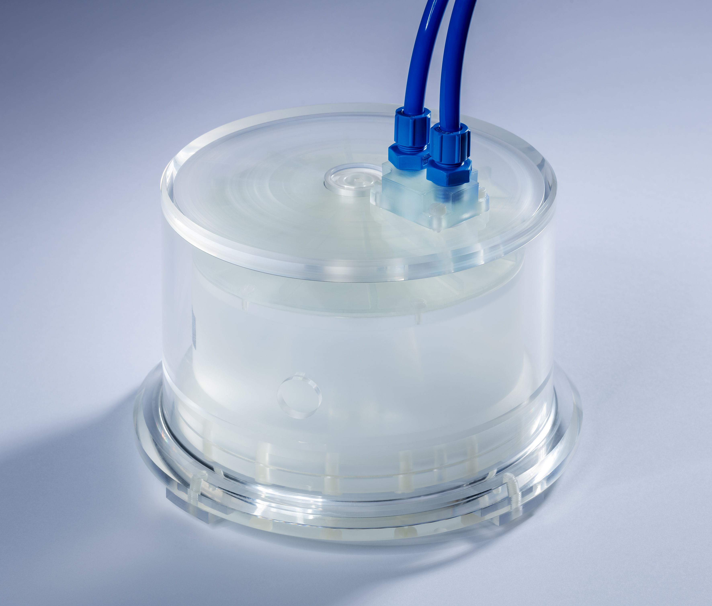
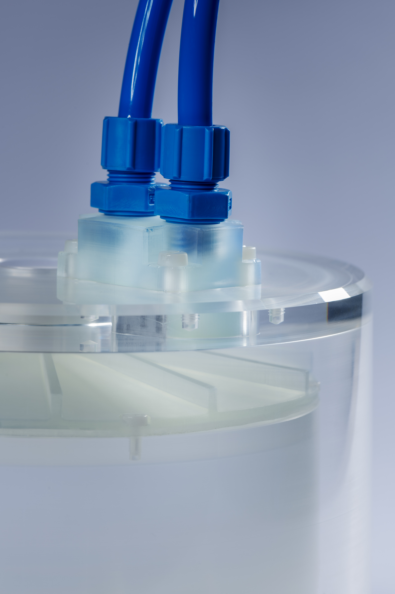
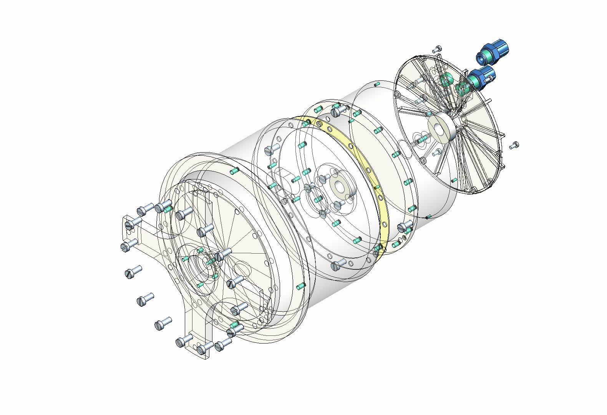
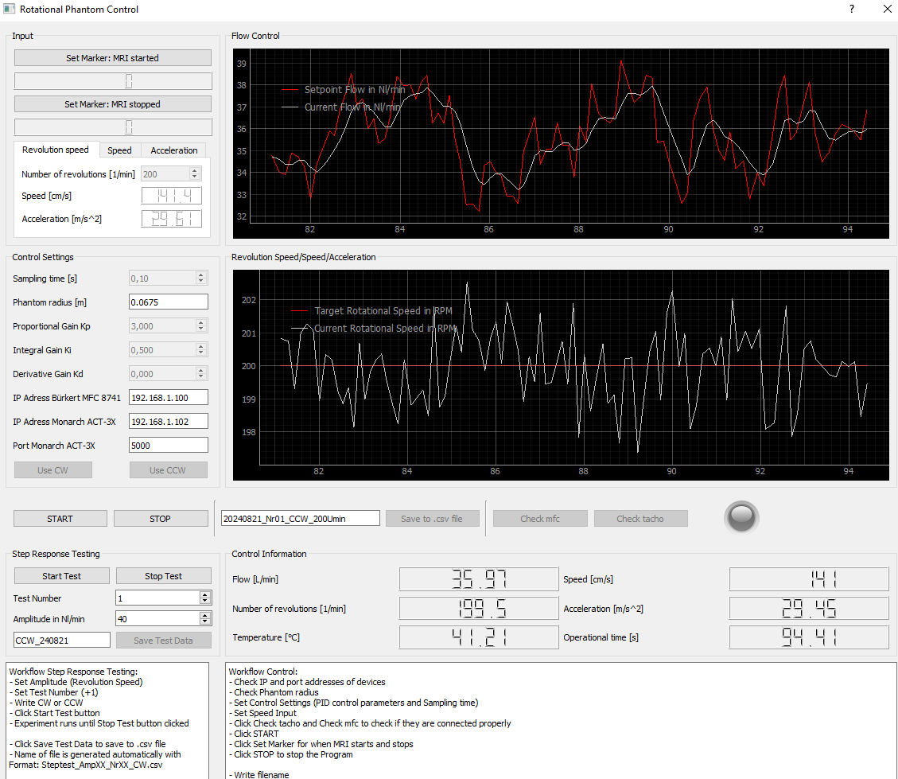
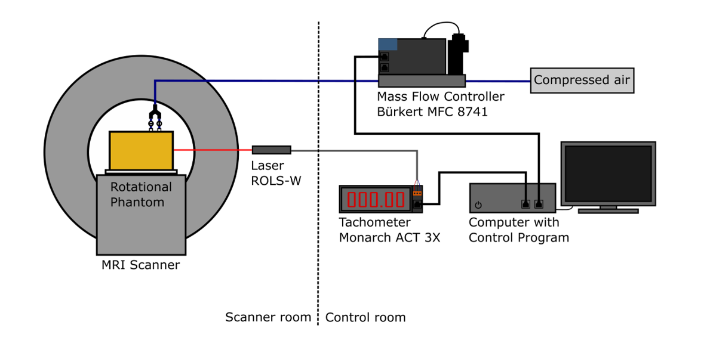

 

# Open-Source Air-Driven Rotational MRI Phantom

This repository accompanies the paper

**“Analytical Ground Truth for Phase-Contrast MRI experiments and simulations: Open-Source Precision-Controlled Bidirectional Rotational Phantom”**

published in IEEE Transactions of Biomedical Engineering by Yu Wang, Sina Thuemmler, Sebastian Schmitter and Hannes Dillinger from Physikalisch-Technische Bundesanstalt (PTB), Department 8.1 - Biomedical Magnetic Resonance, Abbestr. 2 - 12,  D-10587 Berlin, Germany.

It provides all hardware designs, control software and data analysis code required to reproduce the phantom, perform MRI experiments and evaluate displacement artefacts and apparent acceleration sensitivity in phase-contrast MRI (PC-MRI).

Phantom             |  Air inlets
:-------------------------:|:-------------------------:
  |  

## Overview

This project presents a fully open-source, air-driven, bidirectional rotational MRI phantom with analytically defined motion. The phantom enables accurate, reproducible and standardized evaluation of:

- Displacement artefacts in arbitrary MRI sequences  
- Velocity and acceleration sensitivity in PC-MRI  
- Timing offsets between spatial and velocity encoding  
- Agreement between *in-silico* Bloch simulations and *in-vitro* MRI measurements  

A key contribution is the seamless use of the **same MRI sequence definitions** for simulations and experiments, narrowing the gap between numerical modeling and physical validation.

## Main Idea

The analytical velocities are given as $\vec{v}=\vec{\omega}\times\vec{r}$, where $\vec{r}$ denote the radius from the center and $\vec{\omega}=2\pi \, n/60$ with $[n]=1\,\mathrm{rpm}$ the rotational frequency. For a given rotational frequency, the velocities in the encoding directions x and y yield a velocity ramp in y and x directions, respectively. This allows for evaluation of the range of velocities of $v=[-|\vec{v}|,|\vec{v}|]$ within a single PC-MR image.

The apparent acceleration $\vec{a}=\vec{\omega}\times\vec{v}$ for a solid body rotation results in $\vec{a}=-\omega^2\vec{r}$. N.B. the sign of the velocity is dependent on the rotational direction, whereas the apparent acceleration always points towards the center of rotation.

## Key Features

- Bidirectional rotation (clockwise and counterclockwise) driven by actively controlled airflow (PID control)
- MRI-compatible design with external laser-based tachometer  
- Analytically defined ground truth motion for error quantification of MRI velocity estimates
- Fully open-source hardware and software  
- Validated on a 3T MRI system using vendor-supplied and custom PC-MRI sequences  
- Excellent agreement between simulation and experiment  

## Use Cases
- Characterization of sequence timings without knowledge about gradient waveforms
- Evaluation of velocity-to-noise ratios over a broad range of velocities
- Rapid testing of motion-sensitive sequences

## Repository Structure

```bash
.
├───data
|   MRI data (reconstructed and raw)

├───docs
|   Documentation of MRI sequences and external hardware
│   └───hardware_datasheets

├───hardware
|   CAD files and hardware documentation
│   └───Rotationsphantom

├───publication
|   Publication manuscript and supplementary informations
│   └───figures
      Publication figure in SVG format

├───software
│   └───pid
|   Python script for PID control and logging
│   └───sim
|   Python script for MRI simulation
│   └───analysis
|   Python script for data evaluation

|───static
|   Resources for repository
```

## Hardware Description

The phantom consists of:

- A rotating cylindrical container filled with a polyvinylpyrrolidone (PVP)–water mixture  
- Pneumatically driven rotation with active feedback control  
- External laser-based tachometer providing high-precision angular velocity measurements  
- Fully MRI-compatible materials and layout  

Complete CAD files, bills of materials, and assembly instructions are provided in the `hardware/` directory.




## Software and Analysis

All analysis and visualization scripts are written in **Python** and provided in the `software/analysis/` directory.

The code enables:

- Import of MRI magnitude and velocity images  
- Comparison against analytical ground truth motion  
- Quantification of:
  - Displacement artefacts  
  - Apparent acceleration sensitivity  
  - Timing offsets between spatial and velocity encoding  
- Direct comparison of experimental results with Bloch simulations  

The scripts used to generate figures and quantitative results reported in the paper are included.



## Reproducibility and Validation

Using this framework, the following key results were demonstrated:

- Displacement errors causing up to 10% radial stretch at physiological angular velocities  
- Apparent acceleration sensitivity of approximately 5% of venc  
- Quantification of a 1.9 ms timing offset between velocity and spatial encoding without prior sequence knowledge  
- Excellent agreement between MRI experiments and Bloch simulations  

This makes the phantom suitable for:

- Sequence development and benchmarking  
- Quality assurance across MRI systems  
- Cross-institutional validation studies  

## Disclaimer
This repository is provided “as is”, without warranty of any kind, express or implied. The authors and contributors assume no responsibility or liability whatsoever for any damage, malfunction, data loss or safety issues arising from the use of this hard- and software. This explicitly includes, but is not limited to, the use of open-source Pulseq sequences, which may be experimental, incomplete or unsuitable for specific MRI systems and can cause serious damage to MRI hardware or associated equipment if used improperly.

Use of this hard- and software and any associated MR sequence files is entirely at the user’s own risk. It is the user’s sole responsibility to verify correctness, safety, regulatory compliance and suitability for their specific MRI system and experimental setup before use.

## Getting Started

1. **Build the phantom**  
   Follow the instructions in `hardware/rotphantom_drawing_doc.pdf`.

2. **Calibrate the system**  
   See `docs/rotphantom_manual.pdf` for tachometer and airflow calibration.

3. **Acquire MRI data**  
   Use vendor or custom PC-MRI sequences as described in `docs/rotphantom_sequences.pdf`.

4. **Run analysis**  
   Execute the Python scripts in `software/analysis/` to reproduce the evaluation and plots.



## Requirements

- Python
- NumPy  
- SciPy  
- Matplotlib  
- nibabel  

`software/pid/requirements.txt` and `software/sim/requirements.txt` file is provided for convenience.

## License

This project is released under the **MIT License**.

You are free to use, modify, and distribute this work, provided that the original authors are credited. See the `LICENSE` file for details.

## Questions

Check out our department homepage for more information and contact info https://www.ptb.de/cms/ptb/fachabteilungen/abt8/fb-81.html.

## Citation

If you use this phantom, software, or data in your research, please cite the accompanying paper:

```bibtex
@article{OpenSourceRotationalPhantom,
  title   = {Analytical Ground Truth for Phase-Contrast MRI experiments and simulations: Open-Source Precision-Controlled Bidirectional Rotational Phantom},
  author  = {...},
  journal = {...},
  year    = {...}
}
```